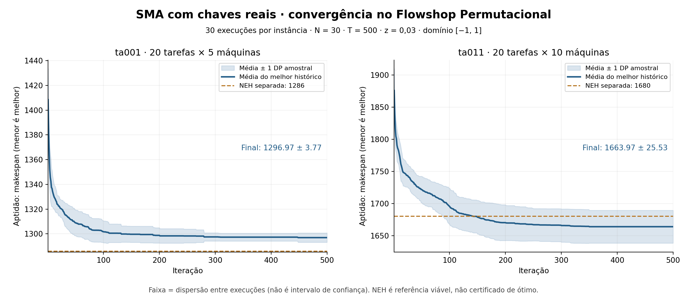

# Relatório experimental: SMA com chaves reais no PFS

## Objetivo e escopo

Implementar em C o núcleo contínuo do SMA e verificar sua aplicação ao PFS
por uma camada SPV (ordenação crescente das chaves). A função objetivo é o
makespan. Não se implementou uma variante híbrida nem um solver exato.
Foram selecionadas duas instâncias oficiais: ta001 (20 tarefas, 5 máquinas)
e ta011 (20 tarefas, 10 máquinas).

## Protocolo executado

Foram realizadas 30 repetições por instância, N=30, T=500, z=0,03, limites
[-1,1] e D=20. Cada repetição faz exatamente 15.000 avaliações: 450.000 por
instância, 900.000 no total. O núcleo foi compilado em C11 com GCC 13.3.0,
`-O2 -Wall -Wextra -Wpedantic -Werror`, sem `-ffast-math`.

As sementes de instância são 873654221 e 587595453. As sementes de execução
estão em `runs.csv`, sem seleção posterior das melhores repetições. O RNG
SplitMix64 é reinicializado a cada repetição. Tempos em CSV são de CPU do núcleo,
incluindo as avaliações, mas excluindo geração de dados, escrita dos CSVs,
estatística e gráficos; não representam benchmark de hardware portátil.

Os valores N, T e z foram conferidos nos arquivos de demonstração dos autores.
A dimensão, os limites e o decodificador são escolhas necessárias para esta
aplicação ao PFS; não são apresentados como parâmetros universais da literatura.

## Convergência e resultados

| Instância | Média inicial | Média final | DP final | Melhor | Mediana | Pior |
|---|---:|---:|---:|---:|---:|---:|
| ta001 | 1408,43 | 1296,97 | 3,77 | 1285 | 1297 | 1305 |
| ta011 | 1875,73 | 1663,97 | 25,53 | 1625 | 1661 | 1742 |

A média inicial é a média do melhor histórico após a primeira avaliação das
30 soluções de cada população. A redução dessa média até a última iteração
foi 7,91% em ta001 e 11,29% em ta011. Não é uma porcentagem de aproximação do ótimo.

A curva contínua mostra a média dos melhores históricos entre execuções.
A faixa representa um desvio padrão amostral, calculado com denominador 29.
Não é intervalo de confiança. O eixo horizontal cobre as iterações 1–500;
a iteração t corresponde a 30t avaliações por repetição.

Observa-se maior estabilidade final em ta001. Em ta011 há maior dispersão entre
sementes. As curvas tornam-se quase planas antes de 500 iterações, compatível
com estagnação; isso não demonstra chegada ao ótimo global.

## Referência viável separada

Uma implementação simples da heurística NEH ordena tarefas por soma decrescente
dos tempos e insere cada tarefa na posição de menor makespan. Empates na soma
usam o menor ID; empates na inserção usam a primeira posição. Ela obteve 1286
em ta001 e 1680 em ta011. As permutações estão em `summary.json`.

Em relação a essa referência, `100*(média SMA - NEH)/NEH` vale +0,85% em ta001
e -0,95% em ta011. O melhor resultado SMA em ta001 foi 1285; porém sua média
foi pior que a NEH. Não se escolheu apenas a melhor execução para representar
o desempenho do método. Em ta011 a média ficou abaixo da referência, mas
algumas execuções produziram soluções piores.

NEH não fornece certificado de ótimo. Os resultados também não são um teste
estatístico de superioridade com orçamento computacional equivalente. A
comparação serve para dar contexto à qualidade, sem modificar o solver.

## Corretude: evidências, não apenas curvas

- Os 100 tempos de ta001 e 200 de ta011 coincidiram exatamente com a saída do
  gerador C distribuído pela OR-Library, executado separadamente.
- As 720 permutações de um problema de 6 tarefas e 3 máquinas foram avaliadas
  tanto pelo C quanto por uma tabela 2D independente. Todos os valores coincidiram.
- O ótimo desse pequeno caso, encontrado por exaustão, foi 353. O SMA com
  N=10, T=100, semente 42 também encontrou 353. É uma verificação pequena,
  não uma prova de que o método encontrará o ótimo em todo problema.
- Foram conferidos 36 pontos de histórico do núcleo C contra um oráculo das
  equações em Python, com o mesmo RNG, cobrindo z=0, z=0,03 e z=1.
- Todas as 60 permutações finais são válidas e foram reavaliadas por uma tabela
  de conclusão independente em Python, coincidindo com o fitness registrado.
- Foram conferidos os 30.000 registros de histórico: valores finitos,
  não crescimento do melhor histórico, sementes e contagem das avaliações.
- Há testes para ranking/decodificação com empate, pesos, objetivo constante,
  fronteiras, rejeição de NaN, parâmetros inválidos e repetição determinística.

## Limitações e fidelidade à demo

A reinicialização escalar da demo produz chaves iguais e, após SPV, a sequência
identidade. Isso reduz a exploração por reinicialização. Uma reinicialização
vetorial poderia ser avaliada como variante futura, mas não foi misturada
silenciosamente ao núcleo entregue.

A fitness não foi normalizada. Diferenças inteiras de makespan fazem `tanh(|S-DF|)`
saturar rapidamente próximo de 1, afetando a frequência dos dois ramos. A
preservação da equação original não significa que sua escala seja ideal ao PFS.

Duas instâncias pequenas são suficientes para o requisito mínimo, mas não
representam toda a coleção Taillard. Não há prova de optimalidade para elas,
comparação ampla com métodos especializados nem alegação de recorde.

A evidência sustenta que o programa implementa as convenções descritas e produz
soluções viáveis com melhoria ao longo das execuções. As referências completas,
o contrato de cada módulo e os comandos de reprodução estão no README.
